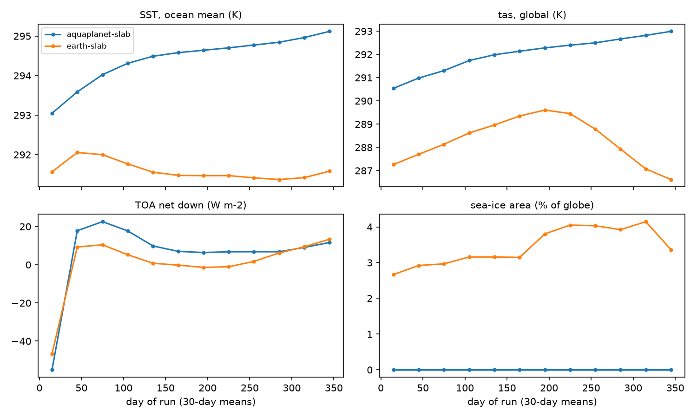
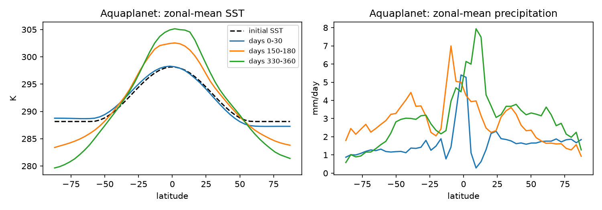
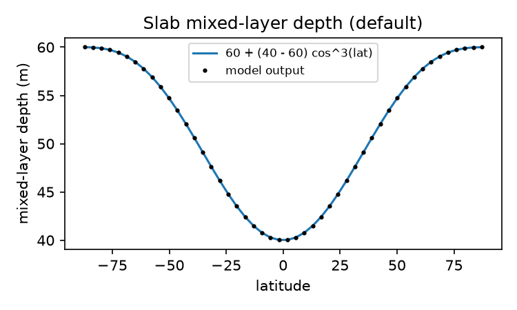
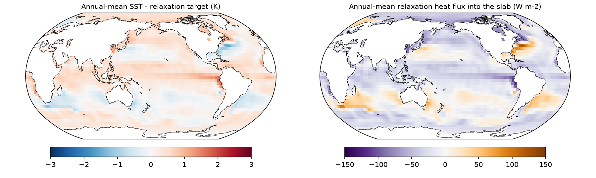
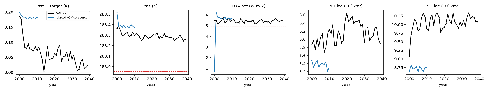
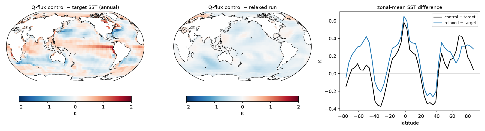
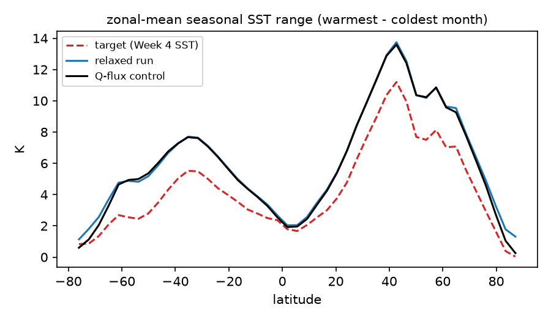

# DSC180 D06 — JCM Project

Team repo. Decision log is in [NOTES.md](NOTES.md).

## Environment

```bash
mamba env create -f environment.yml   # or: conda env create -f environment.yml
conda activate jcm
python check_env.py
```

On DataHub (GPU), also install the CUDA build of jax and check the GPU is visible:

```bash
pip install -U "jax[cuda12]"
python check_env.py --gpu
```

`jax.devices()` should print something like `[CudaDevice(id=0)]`.

## Week 5: slab ocean

Status: Task 1 is done (coltranegowan). Task 2 is done (annalyellis).

### Task 1: first coupled runs

Notebook: [notebooks/Week5_SlabOcean.ipynb](notebooks/Week5_SlabOcean.ipynb) (kernel `jcm-model`, runs on a laptop).
Figures: `figures/week5_*.png`.

- The quick start `python -m jem.main +configuration=aquaplanet-slab coupled_run=short_run` (2 days) and the same
  command with `+configuration=earth-slab` both run in about 14 s on an M2 CPU.
- For the analysis, both configurations ran for 360 days on the laptop (12 min each), with
  `coupled_run=long_run coupled_run.total_time="360 days"`. Output records are 30-day-window means.
  [nrp/extract_jem.py](nrp/extract_jem.py) combines the per-chunk files into
  `results/w5-task1_aquaplanet.nc` and `results/w5-task1_earth.nc` (1.6 MB each; ocean fields are NaN over land).
- Both runs use CO2 = 420 ppmv and start from an isothermal atmosphere. The first 30 days are spin-up.

| | aquaplanet-slab | earth-slab |
|---|---|---|
| Ocean | free slab (`forcing_method: none`) | slab relaxed to SST climatology, τ = 30 days |
| Land / sea ice | none / slab | SPEEDY slab land / slab |
| Boundary file | none (idealized SST start, 288–298 K) | jcm's packaged `bc/t30/clim/forcing.nc` (not Week 4's `forcing_pd.nc`) |
| TOA net, days 30–360 | +11.1 W m-2 | +4.9 W m-2 (Week 4 control: +4.9) |
| Ocean-mean SST | 293.6 → 295.1 K, still warming | steady within 0.6 K |



The aquaplanet energy budget closes: +11 W m-2 into a slab with C = 1.97×10⁸ J m-2 K-1 predicts 1.8 K/yr, and the
measured SST rise is 1.8 K/yr. With no ocean heat transport, the equator-to-pole SST difference grows from 10 K to about 25 K:



**The slab equation** (`SlabOceanModel`): ρ c_p h · dT/dt = −F_up + (Q-flux or relaxation term). The only state is the SST;
F_up is the net surface heat flux, upward positive.

**What sets the mixed-layer depth?** Two parameters only: `h = 60 + (40 − 60)·cos³(lat)` m
(`mixed_layer_depth_min`/`_max` in `SlabOceanParameters`). It does not respond to winds, buoyancy or the seasons.
Heat capacity ρ·c_p·h ≈ 2.0×10⁸ J m-2 K-1 (global-mean h = 48 m); with λ = 1–2 W m-2 K-1, the e-folding time is 3–6 years.



**What does a Q-flux represent?** A prescribed, seasonally varying heat source in each column of the slab: the convergence
of ocean heat transport (currents, upwelling, exchange with the deep ocean) that a motionless slab cannot calculate,
plus a correction for the model's surface-flux biases. The relaxed earth-slab run shows the Q-flux that SPEEDY would need:
heat out at the equator (−39 W m-2 zonal mean, below −100 W m-2 in the east Pacific), heat in along the Gulf Stream and near 40°S,
global mean about −13 W m-2 over ice-free ocean. Two independent estimates (from the SST bias and from the slab's energy budget) agree
(pattern correlation 0.92).



**For Task 2:** jem ships no Q-flux file (`ocean/slab_qflux.yaml` has `q_flux_file: ???`), and a relaxed slab cannot warm
under CO2 (it is pulled back with τ = 30 days). Plan: run a relaxed control on Week 4's `forcing_pd.nc` SST/sea ice,
calculate a monthly `qflux` climatology from it with calendar-month bins (`jem.accumulate.monthly_mean`), then run the Q-flux control.

### Task 2: Q-flux slab control

Notebook: [notebooks/Week5_QfluxControl.ipynb](notebooks/Week5_QfluxControl.ipynb) (kernel `jcm-model`; it reads only `results/`).
Figures: `figures/week5_qflux*.png`.

**Answer:** after a 4.5-year adjustment, the ocean-mean SST stays within **0.05 K** of the Week 4 climatology for 40 years.
The residual drift is −0.03 ± 0.01 K per decade (2σ, 2020–2039). The annual-mean SST is within ±0.7 K in 95% of ocean cells.
The seasonal cycle is about 40% too large, inherited from the relaxed run the Q-flux came from (see below).

The runs used the laptop CPU (M2), about 7.5 min per model year. All of them use Week 4's boundary conditions (SST, sea ice, land,
CO2 = 420 ppmv) and Week 4's terrain, so the slab has 3051 ocean cells:

```bash
python nrp/make_slab_bc.py BC_DIR              # forcing_pd.nc -> T31: BC_DIR/forcing_pd_t31.nc
python nrp/run_slab.py relax  RUN_RELAX --bc forcing_pd_t31.nc --end 2011-01-01        # τ = 30 d, ~1.3 h
python nrp/make_qflux.py RUN_RELAX forcing_pd_t31.nc qflux.nc                          # 2001–2010
python nrp/run_slab.py qflux RUN_Q --bc forcing_pd_t31.nc --qflux qflux.nc --init RUN_RELAX --end 2040-01-01   # ~5 h
python nrp/summarize_slab.py RUN_Q results/w5-task2_qcontrol                           # annual + last-20-yr clim
```

- `run_slab.py` runs one calendar year per `run_chunked` call and saves calendar-month means. It resumes from its checkpoint
  if killed. In qflux mode it starts from the relaxed run's final state, but with the Q-flux ocean's own params and forcing
  (a plain restore would bring back the relaxed run's zero Q-flux).
- `make_qflux.py` computes the Q-flux as the heat the relaxation added, R = C·dTc/dt − C·(T − Tc)/τ, which is exact for
  the slab's implicit step. Monthly means are converted to month-start values, because the slab interpolates its
  climatologies between month starts.
- Results: `results/w5-task2_qflux.nc` (Q-flux and the SST target), `w5-task2_{relax,qcontrol}_{annual,clim}.nc`.

| | Week 4 fixed SST | relaxed slab (2001–10) | Q-flux control (2020–39) |
|---|---|---|---|
| tas (K) | 287.95 | 288.38 | 288.28 |
| TOA net (W m-2) | +4.95 | +5.75 | +5.46 |
| pr (mm/day) | 2.92 | 2.98 | 2.97 |
| ocean SST − climatology (K) | 0 (prescribed) | +0.19 | +0.04 |
| sea-ice area NH / SH (10⁶ km²) | | 5.4 / 8.7 | 6.3 / 10.1 |



- **Drift:** with the relaxation removed, the ocean cools 0.14 K relative to the relaxed run, with an e-folding time of 4.5 years.
  The cooling is mostly poleward of 40°, and sea ice grows by about 16% in each hemisphere (ice-albedo feedback). After about 2010
  the run is steady: TOA has no significant trend, and NH ice has ±0.4 million km² decadal swings with no clear direction.
- **Q-flux:** the ocean mean is −13.4 W m-2 (−4.9 PW), a sink that balances SPEEDY's TOA imbalance. With the mean removed,
  the implied transport is 1.1 PW northward at 17°N but runs equatorward near 45°N/S. So it is a flux correction for
  SPEEDY's surface-flux biases, not a realistic ocean heat transport.
- **Annual bias:** too warm in the equatorial cold tongues (+1 to +2 K) and too cold south of the Kuroshio and Gulf Stream
  and at 40–60°S. The relaxed run has the same pattern.
- **Seasonal cycle:** the range is too large by 1.6 K on average (up to 2.5 K at 40°N and 30°S). The relaxed run has the
  same excess. A fixed 40–60 m mixed layer under SPEEDY's seasonal fluxes produces a larger cycle, and τ = 30 days does not
  hold it back. Possible fix: derive Q from a stronger relaxation, or from fixed-SST surface fluxes.




**For Task 3:**
- Branch from the control's final checkpoint (2040-01-01, 14 MB; ask annalyellis) and use 2020–2039 as the baseline.
- Land is relaxed to climatology with `tdland = 1 day` in earth-slab (SPEEDY default: 40 days), so it is effectively
  prescribed and will hardly warm under CO2.
- Check that a restored checkpoint uses the new `co2` and does not keep 420 ppmv.

### JCM / JEM on NRP (Weeks 4–6)

The DataHub GPU does not work for us, so we run JCM on the NRP JupyterHub
(https://jupyterhub-west.nrp-nautilus.io, UCSD login, ask for 1 GPU).

`pip install jcm jax-esm` from the brief does not work: jax-esm is not on PyPI, and jax-esm needs
one exact jax-gcm commit. [nrp/setup_jcm.sh](nrp/setup_jcm.sh) installs both at the pinned
commits, with CUDA jax:

1. Upload `nrp/setup_jcm.sh` (and any other `nrp/*.py` you need) with the JupyterLab Upload button.
2. In a terminal: `chmod +x ~/setup_jcm.sh && ~/setup_jcm.sh` (about 8 min). The last line must
   print `[CudaDevice(id=0)]`.
3. Select the kernel **Python (jcm-model)**, or use `/tmp/jcm-model/bin/python` in the terminal.

Limits of the JupyterHub server (checked 2026-10-25):
- The home folder is 5 GB, so the env (6.4 GB) goes in `/tmp`. `/tmp` is wiped when the server
  restarts: run `~/setup_jcm.sh` again then. Your home folder stays.
- 8 GB RAM, **1 CPU core**, GPU = GTX 1080 Ti (11 GB). The server stops 1 h after the browser closes.
- Start long runs with `nohup ... &` and add `-u` after `python` so the log updates.

Laptop (CPU only, for small tests and analysis):
`conda create -n jcm-model python=3.12`, then
`pip install -r nrp/requirements.txt` with `jax[cuda12]` changed to `jax` on a Mac.

### Gaussian-process env (Week 3)

The GP emulator (`notebooks/Week3_GaussianProcess.ipynb`) uses GPflow on TensorFlow, which needs
different numpy/ml_dtypes versions than jax. It has its own env so `jcm` stays untouched:

```bash
mamba env create -f environment-gp.yml
conda activate jcm-gp
python -m ipykernel install --user --name jcm-gp --display-name "Python (jcm-gp)"
```

Then pick the **Python (jcm-gp)** kernel in Jupyter. Only tested on macOS (arm64) so far.

## Week 3 baselines: shared prediction format

Each baseline notebook ends by saving its `ssp245` predictions to `results/<model>_ssp245.nc`
(`pattern_scaling`, `gp`, `rf`, `cnn_lstm`), so `notebooks/Week3_Leaderboard.ipynb` (Task 5) can score
every model the same way:

- variables `tas`, `diurnal_temperature_range`, `pr`, `pr90`
- dims `(time, lat, lon)` on the ClimateBench 96 × 144 grid, `time` in years 2015–2100
- precipitation in mm/day (× 86400 from kg m-2 s-1)

The metric code (spatial / global / total NRMSE) is in `metrics.py`; import it to check your scores
while developing. `results/*.nc` files are committed to git so everyone can run the leaderboard.

## Week 4: JCM fixed-SST runs

Status: Task 2 (throughput) and Task 3 (control run) are done (coltranegowan). Task 4 (evaluation)
and Task 5 (variability) are done (annalyellis).

### Task 2: throughput

SPEEDY T31L8, 15-min step, 1 simulated year, timed with [nrp/throughput.py](nrp/throughput.py)
(call 1 = compile + run, call 2 = run only). Raw results: `results/throughput_*.json`.

| Hardware | Compile | Run, 1 sim year | Sim years / hour |
|---|---|---|---|
| NRP GTX 1080 Ti (GPU) | 28.6 s | 64.5 s | 55.8 |
| MacBook Air M2 (CPU, 8 cores) | ~6 s | 6–7 min | 9–10 |
| NRP JupyterHub (CPU, 1 core) | 32.1 s | ~16 min | 3.8 |

- The 1-core CPU number is from a 30-day run, scaled (the cost per step is constant).
- The M2 slows down under sustained load (no fan); its 365-day run gave 8.8, its 10-day run 10.0.
- The 11-year control took 754 s on the GPU (about 52 sim years/hour with compile).

### Task 3: control run

- Command: `python -m jcm.main +configuration=speedy-t31` with monthly means, 2000-01-01 to
  2011-01-01. Full resolved config: [nrp/w4-control_config.yaml](nrp/w4-control_config.yaml).
- Forcing: present-day climatology `hf://bundles/t63/forcing_pd.nc` (SST/sea ice: PCMDI-AMIP
  2005–2014; land: ERA5 2005–2014), replayed every year. Init: isothermal rest.
- **CO2 = 420 ppmv** (`jcm.forcing.DEFAULT_CO2_VMR_PPMV`; the bundle has no `co2` variable).
  The comment `# 360.0` in `jcm/physics/forcing/speedy_forcing.py` is out of date.
- JCM uses an analytic ozone profile on SPEEDY's sigma levels (it logs a warning about this).
- **Spin-up:** the global-mean TOA net flux settles within the first year. Use 2001–2010 for
  the analysis, and drop 2000.

Data for the other tasks: [results/w4-control_monthly.nc](results/w4-control_monthly.nc)
(17 MB, made by [nrp/extract_monthly.py](nrp/extract_monthly.py)). 132 months, T31 grid
(48 lat × 96 lon), 8 sigma levels.

| Variable | Meaning | Units |
|---|---|---|
| `rsdt` | incoming SW at TOA | W m-2 |
| `rsnt` | net (absorbed) SW at TOA | W m-2 |
| `rsut` | reflected SW at TOA (`rsdt - rsnt`) | W m-2 |
| `rlut` | OLR | W m-2 |
| `rtnt` | net downward flux at TOA (`rsnt - rlut`) | W m-2 |
| `tas` | near-surface air temperature | K |
| `ts` | surface temperature | K |
| `pr` | total precipitation (× 86400 for mm/day) | kg m-2 s-1 |
| `evap`, `clt`, `ps_norm` | evaporation, cloud cover, surface pressure / p0 | |
| `ta`, `ua`, `va` | **zonal means** of T, u, v, dims (time, level, lat) | K, m s-1 |

`level` is sigma with the **surface first** (0.9375 … 0.0625). Select levels by value
(`ds.sel(level=0.9375)`), never by index. Weight global means by cos(lat).

### Task 4: control vs ERA5 and NorESM2

Notebook: [notebooks/Week4_Evaluation.ipynb](notebooks/Week4_Evaluation.ipynb) (runs on a laptop, no GPU).
Figures: `figures/week4_*.png`. JCM uses 2001–2010.

References, built by [week4/get_obs.py](week4/get_obs.py) on the T31 grid with the control's variable names
(`results/w4-era5_clim.nc`, `results/w4-noresm2_clim.nc`):

- **ERA5 TOA fluxes:** Copernicus CDS monthly means, 2005–2014. These need a free CDS account, a key in
  `~/.cdsapirc`, and the dataset licence accepted. The raw file goes to `data/` (not in git).
- **ERA5 tas, pr, T, u, v:** WeatherBench2 6-hourly climatology, 1990–2019 (public Google Cloud, no
  account). WeatherBench2 also lists TOA net fluxes, but they are all NaN.
- **NorESM2-LM:** CMIP6 `historical` monthly, mean of r1–r3, 2005–2014 (Pangeo). The ClimateBench files from
  Weeks 1–2 only have annual anomalies of tas and pr, so they can't give seasons, T, u or the TOA terms.

| | JCM | ERA5 | NorESM2-LM |
|---|---|---|---|
| global tas (K) | 287.96 | 287.52 | 288.20 |
| global pr (mm/day) | 2.92 | 2.93 | 2.85 |
| TOA incoming SW (W m-2) | 342.0 | 340.4 | 340.3 |
| TOA reflected SW | 100.4 | 97.7 | 102.4 |
| OLR | 236.7 | 242.0 | 237.3 |
| **TOA net (down)** | **+4.9** | **+0.7** | **+0.6** |

Pattern correlation with ERA5 (area-weighted), with NorESM2 − ERA5 as the benchmark:

| | ANN | DJF | JJA | NorESM2 (ANN) |
|---|---|---|---|---|
| tas r (RMSE, K) | 0.99 (2.7) | 0.97 (4.3) | 0.98 (2.8) | 1.00 (1.5) |
| pr r (RMSE, mm/day) | 0.63 (2.2) | 0.59 (2.8) | 0.62 (3.0) | 0.89 (1.0) |

- **Global means:** close for tas and pr (SST is prescribed). Precipitation patterns are poor: tropical rain is
  grid-scale and noisy.
- **Upper troposphere:** a warm layer at σ = 0.1875 (about 190 hPa) is 33 K warmer than ERA5 in the tropics, an
  inversion. It is in the raw model output, not from interpolation. The jets are too strong (annual 50/60 m/s NH/SH
  against 27/31) and peak near 100 hPa. The Hadley cell is right in shape but about 45% (DJF) and 20% (JJA) weaker.
- **Vertical grid (matters for Task 6):** the control's 8 sigma levels are **evenly spaced**, not SPEEDY's table.
  The CLI's `grid: speedy_t31_l8` builds `SigmaCoordinates.equidistant(8)` (`jcm/runners.py`), while
  `get_speedy_coords()` uses SPEEDY's levels. SPEEDY treats σ < 0.2 as stratosphere (ozone heating, no water-vapour
  LW), which now includes the layer at 0.1875. This is the likely cause of the warm layer (not yet tested).
- **TOA:** the +4.2 W m-2 excess over ERA5 is +1.6 from SPEEDY's insolation (`solc = 342.0`, i.e. S0 ≈ 1368
  against CMIP6's 1361) and +5.4 from too little OLR, partly offset by +2.8 more reflected SW. ERA5 and NorESM2
  differ by about 5 W m-2 on the components, so those numbers are uncertain by a few W m-2.

### Task 5: TOA variability and run length

Same notebook, section 7. Annual global-mean net TOA flux, 2001–2010: SD **0.145 W m-2**, lag-1 autocorrelation
−0.05 (years independent). SE < 0.1 W m-2 needs N ≥ (σ/0.1)²:

- **3 years** for one run's mean. The 10-year control has SE 0.046 W m-2.
- **5 years per run** for an ERF, the difference of two runs (N ≥ 2(σ/0.1)²).
- 2001 is the highest year (5.25). Without it, SD = 0.093. Use 1 year of spin-up + 5 analysed years per
  perturbed run (`run.end_time=2006-01-01`).

### Next tasks: how to start

- **ERF runs (0.5×, 2×, 4×, 8× CO2):** the JCM CLI has no CO2 option; CO2 comes from a `co2`
  variable in the forcing file. On NRP:
  ```bash
  /tmp/jcm-model/bin/python ~/make_co2_forcing.py ~/forcing 0.5 2 4 8   # 210, 840, 1680, 3360 ppmv
  mkdir -p ~/runs/w4-co2x4 && cd ~/runs/w4-co2x4
  nohup /tmp/jcm-model/bin/python -u -m jcm.main +configuration=speedy-t31 \
    forcing.file=$HOME/forcing/forcing_pd_co2x4.nc \
    run.total_time=null run.start_time=2000-01-01 run.end_time=2011-01-01 \
    run.save_interval=1 run.output_averages=true run.chunk_days=30 \
    run.monthly_means=true run.save_chunks=false run.checkpoint_path=ckpt.msgpack \
    hydra.run.dir=$HOME/runs/w4-co2x4 > run.log 2>&1 &
  /tmp/jcm-model/bin/python ~/extract_monthly.py ~/runs/w4-co2x4     # when it finishes
  ```
  From Task 5, 1 year of spin-up + 5 years is enough: `run.end_time=2006-01-01`. Each run is ~1.1 GB on disk: run
  `extract_monthly.py`, download the small file, then delete the run folder, because the home
  folder is 5 GB.
- **Read the vertical-grid note in Task 4 first:** SPEEDY's CO2 absorption acts through the top layers, and the
  control's layers are not SPEEDY's.

